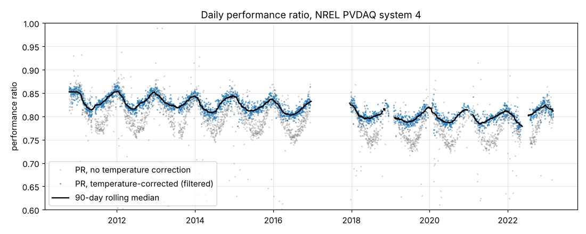
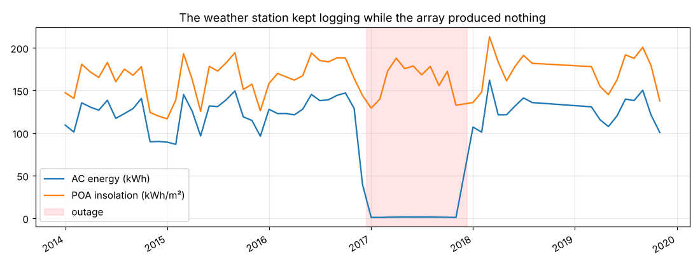
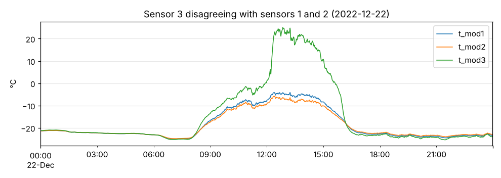
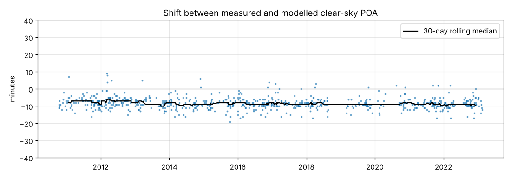

# PV Data Quality & Degradation Analysis

An end-to-end analysis of **13 years of 1-minute field data** from a solar PV system, in two parts:

1. An automated **data-quality (QC) pipeline** that finds and removes bad sensor readings, outages and timestamp problems.
2. **Performance-ratio and degradation-rate** estimation with confidence intervals, validated against NREL's RdTools.

**Data:** [NREL PVDAQ](https://openei.org/wiki/PVDAQ) system 4. It is a 1 kW fixed array of five Sanyo HIT (mono-Si heterojunction) modules at NREL in Golden, Colorado, tilted 40° and facing south. The record runs from January 2010 to February 2023 at 1-minute resolution, about 6.9 million timestamps × 7 channels. All data are public and come from the OEDI open data lake.

## Key results

| | |
|---|---|
| Degradation rate, full record (YoY, temperature-corrected) | **−0.30 %/yr** (95 % CI −0.38 to −0.21) |
| Same data through NREL RdTools | −0.28 %/yr (95 % CI −0.37 to −0.19) |
| Degradation within stable periods (2010–16 and 2018–21) | **−0.39 and −0.37 %/yr** |
| Sensor-independent check (clear-sky model, clear days only) | −0.62 %/yr (wide CI: −1.02 to +0.16) |
| Daylight minutes usable after QC | 74 % |



### What the QC pipeline found

* **A one-year hidden outage (Dec 2016 – Dec 2017).** The array produced nothing while the weather sensors kept logging. Every row exists, so a "missing values" check calls the year complete. Without QC this would read as a 99 % performance loss.

  
* **The logger's "no data" code (−7,999)** sits in 8–11 % of module-temperature readings and in ~45,000 irradiance readings. There are also impossible values such as an ambient temperature of 708,281 °C and irradiance of 3,625 W/m².
* **A failing temperature sensor.** Module sensor 3 disagrees with the other two by more than 5 °C for ~31,000 minutes. The median of three sensors keeps the temperature channel usable.

  
* **Night-time offsets.** The pyranometer reads −3 W/m² at night, a normal thermopile offset. The AC meter reads **+3 W** at night (inverter standby counted as output), which adds almost 1 % phantom energy per year if it is not removed.
* **Timestamps checked against the sun.** Clear-day irradiance was cross-correlated with a pvlib clear-sky model. The data run a constant ~8–9 min early in every year and month. There is no clock drift and no daylight-saving error.

  

### What the degradation analysis shows

* The year-on-year method (each day compared with the same day a year later) gives **−0.30 %/yr**. A from-scratch implementation matches RdTools.
* **The decline is not uniform.** Within each stable period it is about −0.4 %/yr. A step loss across the 2017 outage and a PR recovery in 2022–23 change the single headline number. Segment analysis exposes this.
* **Temperature correction halves the seasonal PR swing** (0.077 → 0.036). Changing the temperature coefficient by ±0.05 %/°C moves the rate by at most 0.05 %/yr.
* **The irradiance sensor is the largest uncertainty.** On clear days the pyranometer trends ~0.3 %/yr lower than the clear-sky model. If that is real sensor drift, true module degradation is closer to 0.6 %/yr. The clear-sky intervals include zero, so this is flagged as a question, not claimed as a finding.

## Repository structure

```
src/
  data.py          download from the OEDI S3 bucket, consolidate daily CSVs to parquet
  qc.py            QC checks: sentinel, range, stuck, sensor disagreement, clear-sky limit,
                   night power, outage, night offsets, clear-day detection, clock offset
  performance.py   temperature-corrected PR, outlier filter, YoY degradation + bootstrap CI
notebooks/
  01_data_quality.ipynb            QC pipeline and findings
  02_performance_degradation.ipynb PR, degradation, sensitivity and sensor checks
metadata/system_4.json             system metadata from PVDAQ
figures/                           all plots
results/                           QC flag counts, daily PR, degradation tables
```

## Reproduce

```bash
pip install -r requirements.txt
python -c "from src import data; data.download_system(4, 'data/raw'); data.consolidate('data/raw', 'data/system4_1min.parquet')"
jupyter nbconvert --to notebook --execute notebooks/01_data_quality.ipynb notebooks/02_performance_degradation.ipynb
```

The download is about 1 GB (≈4,200 daily files). The consolidated parquet is ~200 MB, and `data/` is git-ignored.

## Methods and assumptions

* **Solar geometry and clear-sky irradiance:** pvlib (Ineichen clear-sky model with climatological turbidity) transposed to the 40°/180° plane. Timestamps are treated as local standard time (UTC−7).
* **Performance ratio:** P<sub>AC</sub> / [P<sub>STC</sub> · G<sub>POA</sub>/1000 · (1 + γ(T<sub>mod</sub> − 25))], with P<sub>STC</sub> = 1,000 W and γ = −0.30 %/°C. It is computed daily from minutes with sun elevation > 10° and G<sub>POA</sub> ≥ 200 W/m². Days are kept if they have ≥ 120 such minutes and pass a rolling-median robust z-score filter.
* **Degradation:** year-on-year median with a 2,000-sample bootstrap 95 % CI, cross-checked with RdTools, a linear fit, and a sensor-independent clear-sky PR.
* **Limitations:** single array; no on-site soiling or calibration records; the clear-sky model does not know daily aerosol levels.

## Tools

Python · pandas · NumPy · pvlib · RdTools · Matplotlib · Jupyter

---
*Author: Zekiye Erdem, PhD (photovoltaics). Data courtesy of the National Renewable Energy Laboratory (NREL) PVDAQ.*
